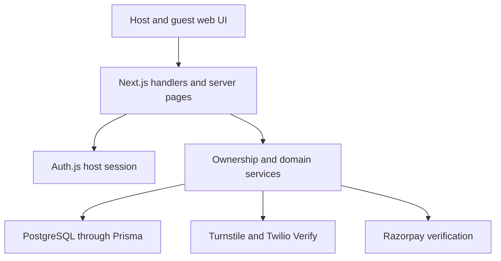

# System Architecture — Wedding Guest Manager

Updated 11 November 2026. This document describes the current web implementation and separates the remaining product targets. Verification status is maintained in [the implementation tracker](implementation-tracker.md).

## Current implementation

| Layer | Implementation | Evidence |
|---|---|---|
| Web | Next.js 15 App Router, React 19, TypeScript, Tailwind | `package.json`, `app/`, `components/` |
| Host authentication | Auth.js v5 credentials provider, bcrypt hashes, JWT sessions | `auth.ts`, `app/api/register/route.ts`, `lib/auth-login.ts` |
| Database | PostgreSQL through Prisma 6 | `prisma/schema.prisma`, `prisma/migrations/`, `lib/prisma.ts` |
| Production database target | Supabase PostgreSQL | `docs/Rules.md`, `docs/SUPABASE_MIGRATION_PLAN.md` |
| Payments | Razorpay REST orders, captured-payment verification, signed webhook | `lib/subscriptions/`, `app/api/webhooks/razorpay/route.ts` |
| Guest verification | Twilio Verify SMS and Cloudflare Turnstile | `lib/rsvp-otp.ts`, `lib/captcha.ts`, `app/api/rsvp/phone/` |
| Tests | Jest, database integration tests, HTTP smoke, Playwright | `__tests__/`, `scripts/smoke-e2e.mjs`, `tests/e2e/` |
| Hosting configuration | Vercel build and retention cron | `vercel.json`, `vercel-build.sh` |

Supabase Auth migration remains a separate planned change. The current authentication implementation is retained under `docs/Rules.md` and the migration plan. Production database access and Supabase Data API exposure require a deployment review because the tracked schema does not establish tenant RLS policies.

## Repository layout

| Directory | Responsibility |
|---|---|
| `app/` | Host pages, public invitation/RSVP pages, admin pages, API handlers |
| `components/` | Forms, managers, dashboard, check-in, policy and billing UI |
| `lib/` | Validation, authorization, domain rules, providers and reports |
| `prisma/` | Actual data model, migrations and synthetic development seed |
| `__tests__/` | Unit and PostgreSQL integration checks |
| `tests/e2e/` | Browser journeys |
| `scripts/` | HTTP smoke and local verification provider |
| `docs/` | Canonical requirements, decisions and verification record |
| `inbox/` | Supplied reference document copies |

The proposed Expo and shared-package layout in the original documents is a future target. The current repository has no native app implementation.

## Runtime flow

All private operations resolve the authenticated user and wedding ownership server-side. Public handlers use invitation credentials and explicit public field projections. Browser controls supplement server authorization.

## Account and wedding boundaries

An account is represented by a `Workspace`, connected to users through `WorkspaceMember`. A wedding belongs to one workspace and owns its events, guests, RSVP responses, questions, group invitations and wedding audit entries.

New paid access is derived from verified payment records tied to a specific wedding. The historical `Subscription` model remains for earlier workspace purchases. Legacy records must retain their existing history while new checkout uses wedding identity, plan price and tax snapshots. Plan entitlement services remain the common authorization surface.

## Invitation and RSVP trust

The wedding-wide shared invitation is available to multiple guests. Private group invitations require an explicit first-open claim and an HttpOnly browser cookie. RSVP edit access requires its edit credential and the browser that owns it. A one-time transfer confirmation moves access to another browser and revokes the old credential.

Phone verification proofs are scoped to the invitation, phone and browser. RSVP persistence runs in a transaction. Wedding and event deadlines use server time. Normal edits preserve the edit link, while ownership transfer rotates access. The current security review and regression coverage must confirm each boundary before release.

Public display settings are projected by `lib/public-wedding.ts`. Guest contacts and private notes are excluded from public invitation data. Host report contact columns follow the wedding's contact visibility preference.

## Lifecycle

`lib/wedding-lifecycle.ts` derives expiry from the stored wedding calendar date and IANA timezone. A wedding on 10 December in Asia/Kolkata expires on 11 December at 00:00. Editing and public RSVPs then close, while authorized historical viewing and available exports continue.

`lib/wedding-retention.ts` calculates deletion eligibility for 18 December at 00:00 in that example. The cron handler requires `CRON_SECRET` and defaults to a dry run. Deletion requires the explicit retention-enable setting. Nullable payment wedding references preserve payment history after wedding removal.

Deletion reminder delivery, durable deletion results, asset cleanup and backup purge remain separate requirements in the tracker. Their presence in the product specification does not establish an implemented worker or verified operational policy.

## Configuration and audit

Plan definitions are centralized in `lib/subscriptions/config.ts`; persisted plan configuration is administered server-side. Platform settings include business details, GST calculation settings and controlled ad placements. GST and advertisements start disabled. Payment order snapshots preserve the amounts presented at purchase.

Policy acceptance is versioned and recorded for the authenticated user. Admin access requires trusted provisioning or a verified account on the configured allowlist. Ordinary registration cannot establish admin status merely by choosing an allowlisted email address.

## Remaining architectural targets

- Supabase Auth migration and production RLS/access review.
- Managed private asset storage and complete asset lifecycle.
- Cashfree adapter if included in the approved payment rollout.
- Email and official WhatsApp delivery with retries and consent controls.
- Native Expo workflows and expanded locale/currency coverage.
- Broad platform administration, strong admin authentication, monitoring and restore acceptance.

Keep these targets in the requirement map until code and executed acceptance evidence establish completion. Avoid replacing the working modular web application solely to match the proposed folder diagram.
